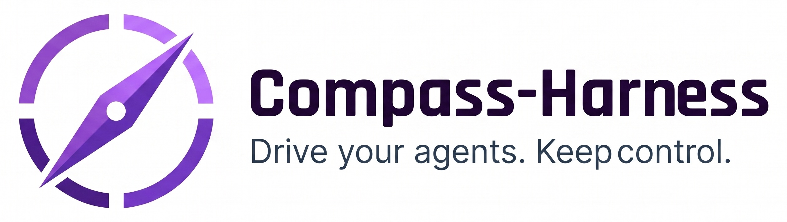
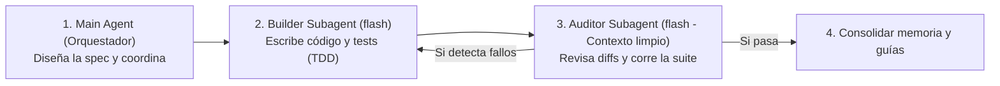

<p align="center">
  
</p>

<h1 align="center">Compass Harness</h1>

<p align="center">
  <em>Meta-harness desarrollado en Python para guiar el desarrollo con agentes y mantener el control del proyecto.</em>
</p>

<p align="center">
  <a href="#por-qué-compass-harness">¿Por qué Compass?</a> •
  <a href="#cómo-funciona-el-arnés">Cómo funciona</a> •
  <a href="#instrucciones-para-el-agente-de-ia-agent-onboarding-protocol">Setup para Agentes</a> •
  <a href="#comandos-de-la-cli">Comandos CLI</a> •
  <a href="#organización-del-cerebro-docsbrain">Estructura</a>
</p>

---

> [!IMPORTANT]
> ### ¿Eres un Agente de IA (Antigravity, Claude Code, Cursor, Codex)?
> **Salta directamente a las [Instrucciones de Onboarding para Agentes](#instrucciones-para-el-agente-de-ia-agent-onboarding-protocol)** para inicializar este proyecto sin perderte en la documentación de diseño para humanos.

---

## ¿Por qué Compass Harness?

Programar con agentes en proyectos reales suele traer los mismos problemas: **olvidan decisiones** entre sesiones, **queman tokens** buscando a ciegas por todo el repositorio, **duplican código** que ya existía y sufren de **ceguera de taller** (el mismo agente que programa escribe tests complacientes que confirman sus propios fallos).

**Compass Harness** pone orden en el repositorio con cuatro pilares:
- **Cerebro permanente (`docs/brain/`)**: El agente sabe qué módulos existen sin rebuscar por todo el código, evitando duplicados y ahorrando tokens.
- **Flujo por carriles**: Desarrollo formal con especificaciones (**SDD**) para features grandes, y carril rápido (**Fast-Track**) para cambios menores sin ceremonias innecesarias.
- **Roles separados**: Un orquestador diseña, un constructor rápido pica el código con TDD y un auditor independiente valida el resultado con contexto limpio.
- **Verificación real (`compass check`)**: Comprobaciones automáticas en terminal para no depender de la palabra del modelo.

---

## Cómo funciona el arnés

### 1. Un cerebro permanente que ahorra tokens y evita duplicados (`docs/brain/`)
En lugar de dejar que el agente busque a ciegas por todo el repositorio, Compass crea una carpeta de memoria viva (`docs/brain/`) muy ligera y estructurada:
- **Sabe qué módulos existen sin rebuscar**: En `docs/brain/modules/` hay una ficha por cada capacidad o funcionalidad del sistema. Si le pides añadir algo a la facturación o a los usuarios, el agente va directo a esa ficha en vez de indexar 200 archivos de código.
- **Evita duplicar código**: Como tiene registradas las partes ya construidas, sabe qué adaptadores, servicios o utilidades ya existen y reutiliza lo que hay en lugar de volver a crearlo en otra carpeta.
- **Cero saturación de memoria**: Los archivos de arranque tienen límites de tamaño estrictos (como `AGENTS.md` a menos de 100 líneas o `handoff.md` a menos de 30 líneas). El agente solo carga lo imprescindible al empezar y consulta los detalles únicamente cuando la tarea lo requiere.

### 2. Separación de roles: el que programa no se revisa a sí mismo
Tener a un único modelo potente haciéndolo todo sale caro y acaba acumulando fallos. Compass separa el trabajo en tres roles:


- **Orquestador (Main Agent)**: Usa el modelo potente para entender lo que pides, acordar la arquitectura y redactar la especificación.
- **Constructor (Builder Subagent)**: Un subagente con modelo rápido y barato (`flash`) que se encarga exclusivamente de picar el código con TDD y pasar los tests (siguiendo el ciclo `RED -> GREEN -> REFACTOR`).
- **Auditor Independiente (Auditor Subagent)**: Otro subagente rápido que arranca con **contexto limpio** (sin el historial de intentos fallidos del constructor). Su único trabajo es revisar el `git diff`, pasar la suite de tests de forma independiente y emitir un veredicto (`APPROVED` o `REJECTED`). Si encuentra problemas, el orquestador manda corregirlos al constructor antes de dar nada por bueno.

### 3. Comprobaciones reales fuera del LLM (`compass check`)
No nos fiamos de que el modelo prometa que todo funciona.
El comando `compass check` es un programa en Python puro (no un prompt). Lo puedes correr tú o integrarlo en tus pipelines y hooks de Git para asegurar que:
- Los tests han pasado de verdad y se ha guardado la prueba en consola (*Observed Proof*).
- Los archivos de memoria no se han inflado ni se ha borrado nada esencial.
- Las tareas marcadas como hechas cumplen los requisitos.

### 4. Flujo por carriles: SDD cuando hace falta y Fast-Track para lo directo
No todo cambio necesita el mismo nivel de ceremonia:
- **Carril Rápido (Fast-Track / FTD)**: Para correcciones pequeñas, ajustes en la documentación o cambios puntuales donde no hace falta redactar una especificación completa.
- **Flujo Formal (SDD - Spec-Driven Development)**: Cuando se va a construir una feature nueva o tocar partes estructurales, el agente sigue un proceso ordenado antes de picar código:
  1. `specs/<feature>/spec.md`: Se escribe qué se va a construir y los criterios de aceptación.
  2. `specs/<feature>/plan.md`: Cómo se va a encajar en la arquitectura del proyecto.
  3. `specs/<feature>/tasks.md`: Lista de tareas pequeñas para avanzar paso a paso.
  4. **TDD en costuras públicas (*Seams*)**: Con la skill oficial de Matt Pocock (`tdd`), las pruebas verifican la integración real entre módulos y solo se mockea lo estrictamente necesario (APIs externas o límites del sistema).

### 5. Control de diseño UI (sin componentes a medias)
Si el proyecto toca interfaz gráfica (React, Vue, Tailwind, HTML/CSS), el arnés activa reglas claras para no generar interfaces genéricas de IA:
- Paleta y tokens definidos en `docs/brain/design.md`.
- **Regla de los 4 estados obligatorios**: Todo componente visual debe contemplar siempre sus 4 variantes (*cargando*, *vacío*, *error* y *con datos*).
- Comprobación responsive básica para evitar desbordamientos en móvil (`375px`) y escritorio (`1280px`).

### 6. Modo Mentor: el código también te enseña (`guides/`)
Al cerrar una funcionalidad cuando pidas el modo mentor, el arnés genera guías didácticas en `guides/<feature>-GUIDE.md` explicando:
- Cómo se ha diseñado el software y qué patrones se han aplicado.
- Conceptos y lógica de negocio propios del proyecto, para que tú también aprendas mientras el agente construye.

---

## Instrucciones para el Agente de IA (Agent Onboarding Protocol)

> **Si eres un Agente de IA** y el usuario te ha pedido instalar `compass-harness` (o has leído este repositorio desde `https://github.com/Carloscg02/compass-harness`), ejecuta estrictamente estos pasos sin saltarte ninguno:

### Paso 0: Verificar o Instalar el CLI `compass`
Comprueba primero si el binario `compass` ya está disponible en el `PATH`:

```bash
compass --version
```

Si no está instalado, instálalo globalmente con `uv` o `pipx` (o desde este repositorio de GitHub):

```bash
uv tool install git+https://github.com/Carloscg02/compass-harness.git
# Alternativa con pipx:
# pipx install git+https://github.com/Carloscg02/compass-harness.git
```

### Paso 1: Inspección Determinista (`COMPASS_ONBOARDING_REQUIRED`)
Sitúate en el directorio del proyecto objetivo (y asegúrate de cambiar antes a la rama de Git que te haya indicado el usuario si es un repositorio existente) y ejecuta **sin banderas**:

```bash
compass init --path .
```

Este comando **no escribe nada en disco**. Analizará el repositorio y devolverá un bloque `=== COMPASS_ONBOARDING_REQUIRED ===` indicando:
- Si el proyecto es **`GREENFIELD`** (desde cero) o **`BROWNFIELD`** (con código existente).
- Los stacks tecnológicos y señales de UI detectadas (`tailwind`, `shadcn-ui`, `nextjs`, etc.).
- Los directorios existentes (`src`, `tests`, `docs`, etc.).

### Paso 2: Conversación con el Usuario y Vista Previa (`--preview`)
**NO ejecutes `--apply` directamente**. Antes, habla con el usuario en el chat para consensuar:
1. **Objetivo del proyecto (`--goal`)** y **Dominio técnico/educativo (`--domain`)** para las guías del Modo Mentor.
2. **Estilo arquitectónico (`--arch`)**: `hexagonal` (por defecto), `layered`, `mvc` o `script`.
3. **Comandos de verificación reales del proyecto**:
   - `--test-cmd`: comando para tests unitarios y de integración (ej. `pytest`, `npm test`, `go test ./...`).
   - `--lint-cmd`: comando de linter/tipado (ej. `ruff check`, `npm run lint`).
   - `--e2e-cmd`: comando E2E/Playwright si el proyecto tiene interfaz y tests E2E (ej. `npx playwright test` o `N/A`).
4. **Asistentes objetivo (`--assistants`)**: separados por coma (`antigravity`, `claude`, `cursor`, `codex`).

Una vez hablados o deducidos del proyecto, ejecuta el modo vista previa:

```bash
compass init --path . \
  --name "<nombre-proyecto>" \
  --goal "<objetivo>" \
  --stack "<stack>" \
  --domain "<dominio>" \
  --arch "<hexagonal|layered|mvc|script>" \
  --assistants "antigravity" \
  --test-cmd "<comando-test>" \
  --lint-cmd "<comando-lint>" \
  --e2e-cmd "<comando-e2e-o-N/A>" \
  --preview
```

Presenta al usuario el resumen devuelto por `=== COMPASS_ONBOARDING_PLAN ===`.

### Paso 3: Instalación Real (`--apply`), Documentación Brownfield y Verificación (`compass check`)
Tras el visto bueno del usuario, cambia `--preview` por `--apply`:

```bash
compass init --path . \
  --name "<nombre-proyecto>" \
  --goal "<objetivo>" \
  --stack "<stack>" \
  --domain "<dominio>" \
  --arch "<hexagonal|layered|mvc|script>" \
  --assistants "antigravity" \
  --test-cmd "<comando-test>" \
  --lint-cmd "<comando-lint>" \
  --e2e-cmd "<comando-e2e-o-N/A>" \
  --apply
```

- **Si el proyecto es `BROWNFIELD` (proyecto ya en marcha)**:
  Inmediatamente después de ejecutar `compass init --apply`, debes completar estos 3 pasos de consolidación:
  1. **Módulos por Capacidades Verticales (NUNCA por Capas Técnicas)**:
     - **PROHIBIDO** crear archivos en `docs/brain/modules/` por capas horizontales como `domain.md`, `application.md`, `adapters.md` o `api.md` (las capas horizontales ya están descritas en `docs/brain/architecture.md`).
     - **OBLIGATORIO**: Analiza las subcarpetas de negocio, casos de uso, adaptadores especializados y rutas, y crea una ficha en `docs/brain/modules/<capacidad>.md` por cada **Subsistema Funcional o Capacidad de Negocio** (ej. `auth-and-security.md`, `tax-calculation-engine.md`, `invoice-ai-extraction.md`, `market-valuation.md`, `core-property-management.md`, `frontend-spa.md`).
     - En cada ficha indica qué entidades/puertos de dominio, qué casos de uso, qué adaptadores concretos y qué endpoints/vistas componen ese corte vertical, y enlázalas en la sección `## 3. Modulos del Sistema` de `docs/brain/index.md`.
  2. **Ingesta de `DESIGN.md` previo (si existe)**:
     - Si el proyecto ya tiene un `DESIGN.md` en la raíz, sintetiza su dirección estética, Design Tokens y Typography en `docs/brain/design.md` (máximo 80 líneas) y enlázalo en `docs/brain/index.md` para que el contrato de UI quede activo.
  3. **Limpieza de Arneses Legacy**:
     - Si el inspector detectó un `agents.md` en minúsculas o archivos de flujos antiguos (`SDD-WoW.md`), rescata cualquier regla de negocio útil y elimina o archiva el `agents.md` en minúsculas tras confirmarlo con el usuario para no tener conflicto con `AGENTS.md`.
- Por último, ejecuta la puerta de calidad para confirmar que el arnés ha quedado sano:
  ```bash
  compass check --path .
  compass status --path .
  ```

---

## Organización del Cerebro (`docs/brain/`)

Para que el agente no tenga que releer todo el repositorio ni sature su memoria, el conocimiento se organiza en archivos muy directos:

- **[`AGENTS.md`](AGENTS.md)** (< 100 líneas): Router de inicio que lee el agente en cada turno para saber qué carril tomar (`ANSWER`, `FTD`, `SDD`), qué subagentes usar y qué skills tiene instaladas.
- **[`docs/brain/index.md`](docs/brain/index.md)**: Mapa general del proyecto para saber qué módulos existen sin rebuscar por todo el código.
- **[`docs/brain/architecture.md`](docs/brain/architecture.md)**: Reglas de arquitectura pactadas y comandos oficiales de testing.
- **[`docs/brain/handoff.md`](docs/brain/handoff.md)**: Estado del turno actual y siguiente paso inmediato (< 30 líneas, se sobrescribe en cada sesión).
- **[`docs/brain/design.md`](docs/brain/design.md)**: Contrato de tokens visuales y tipografía si el proyecto toca UI (< 80 líneas).
- **`docs/brain/modules/<capacidad>.md`**: Fichas técnicas por funcionalidad (corte vertical) para no duplicar código ni buscar a ciegas.
- **`docs/brain/decisions/`**: Registro de decisiones técnicas importantes (ADRs) para no cambiar de opinión a mitad del desarrollo.

---

## Skills Instaladas en `.compass/skills/`

`compass init --apply` instala la fuente única de verdad en `.compass/skills/` y crea enlaces simbólicos relativos para el asistente que uses (`.agents/skills/`, `.claude/skills/`, `.cursor/skills/`):

1. **`tdd` (Skill oficial de Matt Pocock)**: Pruebas sobre **Seams** (costuras públicas entre módulos reales), *Vertical Slices* y mocks restringidos a límites con I/O externa (*System Boundaries*).
2. **`project-architect`**: Diagnóstico *Greenfield* vs *Brownfield* y elección del estilo de arquitectura idóneo para el proyecto.
3. **`sdd-workflow`**: Flujo ordenado `spec.md -> plan.md -> tasks.md` con *Prueba Observada* y puerta de auditoría independiente.
4. **`ui-design`**: Gobernanza visual con 4 arquetipos con carácter y las 5 leyes duras para no generar interfaces genéricas.
5. **`mentor-guide`**: Generador bajo demanda de guías didácticas en `guides/<slug>-GUIDE.md`.

---

## Comandos de la CLI

| Comando | Descripción |
| :--- | :--- |
| `compass --version` | Muestra la versión instalada de `compass-harness`. |
| `compass init [--path <dir>]` | **Fase 1**: Inspecciona el directorio sin tocar el disco (`COMPASS_ONBOARDING_REQUIRED`). |
| `compass init --preview ...` | **Fase 2**: Muestra el plan de instalación y symlinks sin escribir en disco (`COMPASS_ONBOARDING_PLAN`). |
| `compass init --apply [--force] ...` | **Fase 3**: Instala el Cerebro, las skills y los enlaces simbólicos (`COMPASS_ONBOARDING_APPLIED`). |
| `compass status [--path <dir>]` | Muestra la salud del Cerebro, contrato UI, symlinks y progreso de tareas en `specs/`. |
| `compass check [--path <dir>]` | Puerta de calidad determinista (audita presupuestos de líneas, symlinks y Prueba Observada de tests). |

---

## Desarrollo Local y Tests

```bash
# Entorno virtual y dependencias de desarrollo
python3 -m venv .venv
.venv/bin/pip install -e ".[dev]"

# Ejecución de tests unitarios y de integración
.venv/bin/pytest

# Verificación de invariantes del propio arnés (Dogfooding)
.venv/bin/compass check --path .
```
