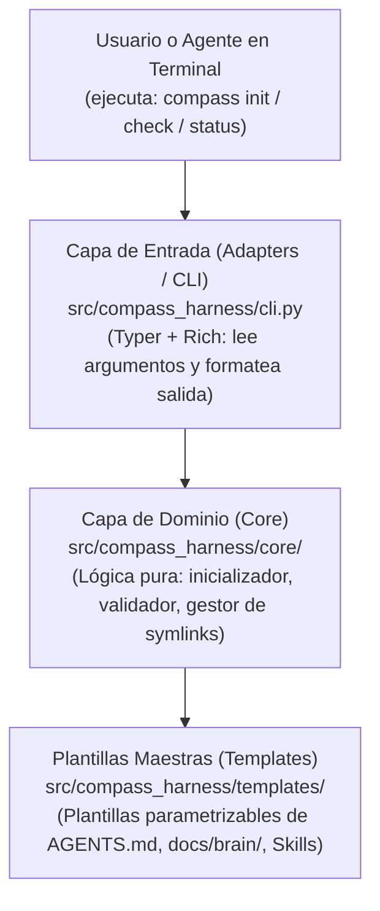

# Arquitectura de `compass-harness`

## 1. Decisión de Arquitectura (Onboarding)
Siguiendo la filosofía de `compass` (proponer Arquitectura Hexagonal/DDD por defecto, pero adaptar el diseño al tamaño y naturaleza real del proyecto):

- **Naturaleza del proyecto**: Herramienta CLI local de automatización de archivos, plantillas y verificaciones en terminal (sin base de datos compleja ni múltiples motores externos cambiantes).
- **Estilo elegido**: **Arquitectura Limpia Simplificada (3 Capas: CLI / Core / Templates + FileSystem)**.
  - *¿Por qué no DDD/Hexagonal completo con decenas de Puertos y Adaptadores aquí?* Porque para una herramienta CLI de gestión de archivos sería sobreingeniería innecesaria.
  - *¿Qué principio de Arquitectura Hexagonal SÍ conservamos?* **La separación estricta entre la Interfaz de Usuario (Terminal/CLI) y la Lógica de Dominio (Core)**. La lógica que crea el cerebro o valida un proyecto nunca hace `print()` directamente ni depende de la librería de consola: devuelve datos limpios, y la capa CLI decide cómo mostrarlos en pantalla. Así es 100% testeable con `pytest`.

---

## 2. Diagrama de Capas



---

## 3. Estructura Objetivo del Repositorio

Diferenciamos claramente entre **los archivos de gobierno de este repositorio** (en la raíz) y **las plantillas genéricas que el CLI instalará en otros proyectos** (dentro de `src/compass_harness/templates/`):

```text
compass-harness/
├── AGENTS.md                        # Instancia concreta para desarrollar compass-harness
├── pyproject.toml                   # Configuración del paquete y comando `compass`
├── docs/
│   └── brain/                       # Memoria viva de compass-harness
│       ├── index.md
│       ├── architecture.md
│       ├── decisions.md
│       └── handoff.md
├── specs/                           # Especificaciones SDD de cada feature de compass-harness
├── guides/                          # Guías educativas generadas para Carlos
├── src/
│   └── compass_harness/
│       ├── __init__.py
│       ├── cli.py                   # Punto de entrada Typer (comandos CLI)
│       ├── core/                    # Lógica de negocio desacoplada de la consola
│       └── templates/               # PLANTILLAS GENÉRICAS que `compass init` instalará en futuros proyectos
└── tests/                           # Suite de tests (TDD con pytest)
```

---

## 4. Reglas Inquebrantables de Código
1. **Layout `src/`**: Todo el código del paquete vive dentro de `src/compass_harness/` para evitar errores de importación en los tests.
2. **Tipado explícito (*Type Hints*)**: Todas las funciones públicas llevan tipos de entrada y retorno (`def init_project(path: Path) -> InitResult:`).
3. **TDD Estricto**: Ninguna funcionalidad en `core/` o `cli.py` se escribe sin antes tener su test fallando en `tests/`.
