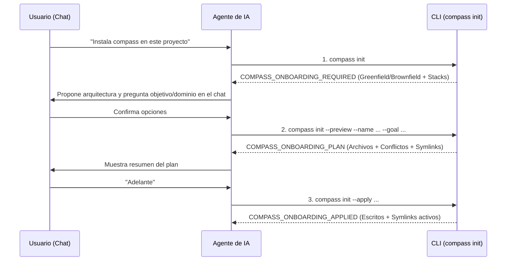

# Guía de Ingeniería (Paso 4): Máquina de Estados CLI para Agentes, Enlaces Simbólicos Relativos e Idempotencia

Esta guía explica las decisiones de arquitectura y sistemas operativos aplicadas al implementar el Paso 4 (**`04-agent-onboarding`**) en [`installer.py`](../src/compass_harness/core/installer.py) y [`cli.py`](../src/compass_harness/cli.py).

---

## 1. Por qué las CLIs para Agentes de IA NO deben usar `input()` interactivo

En una CLI tradicional para humanos (por ejemplo `npm init` o `poetry init`), el programa lanza preguntas interactivas bloqueando la entrada estándar (`stdin`) hasta que el usuario pulsa `Enter`.

Cuando un **agente de IA** (como Antigravity, Claude Code o Cursor) ejecuta un comando mediante su herramienta de terminal (`run_command`), un `input()` bloqueante provoca dos fallos graves:
1. **Cuelgue de proceso (Timeout)**: La herramienta espera a que el proceso termine antes de devolver la salida al LLM. Como el proceso está bloqueado esperando `stdin`, el comando agota su tiempo de espera o se queda en segundo plano indefinidamente.
2. **Pérdida del canal de conversación rico**: El humano está hablando con el agente en la interfaz del chat, no mirando una terminal oculta en segundo plano.

### La Solución: Protocolo de Máquina de Estados sin Estado (*Stateless 3-Phase Handshake*)
En lugar de mantener un proceso vivo esperando `stdin`, cada invocación a `compass init` arranca, ejecuta una fase determinista en milisegundos, imprime una directiva estructurada y **termina con código de salida `0`**:



---

## 2. Anatomía de los Enlaces Simbólicos Relativos (`os.path.relpath` + `Path.symlink_to`)

En [`installer.py`](../src/compass_harness/core/installer.py), queremos que `.agents/skills/tdd` apunte a `.compass/skills/tdd`. Existen dos maneras de crear un enlace simbólico en Linux/macOS:

1. **Symlink Absoluto (Mal patrón para repositorios Git)**:
   - `.agents/skills/tdd -> /home/carlos/mi-proyecto/.compass/skills/tdd`
   - **Problema**: Si mueves la carpeta del proyecto a otra ruta, o si un compañero clona el repositorio en `/Users/ana/mi-proyecto`, el enlace simbólico queda **roto (*dangling symlink*)** porque busca `/home/carlos/...`.
2. **Symlink Relativo (El patrón que hemos implementado)**:
   ```python
   link_abs = target_root / symlink.link_path      # /ruta/proyecto/.agents/skills/tdd
   target_abs = target_root / symlink.target_path  # /ruta/proyecto/.compass/skills/tdd
   relative_target = os.path.relpath(target_abs, link_abs.parent)
   # relative_target == "../../.compass/skills/tdd"
   link_abs.symlink_to(relative_target, target_is_directory=True)
   ```
   - **Por qué `link_abs.parent`**: En el estándar POSIX (Linux/Unix), la ruta almacenada dentro de un enlace simbólico se resuelve siempre **relativa al directorio donde vive el propio enlace** (`.agents/skills/`), NO relativa al directorio desde donde ejecutaste el comando. Subiendo dos niveles (`../../`), llegamos a la raíz del proyecto y entramos en `.compass/skills/tdd`. Así puedes mover, comprimir o pushear a Git el repositorio y el symlink nunca se rompe.

---

## 3. Idempotencia y Protección contra Sobrescritura (`force=False`)

En ingeniería de sistemas, una operación es **idempotente** y segura cuando puedes ejecutarla múltiples veces sobre un directorio existente sin corromper datos previos:
- Si ejecutas `compass init --apply` en un proyecto *Brownfield* que ya tenía su propio `AGENTS.md`, la función `apply_installation` comprueba `if file_path.exists() and not force: skipped_files.append(rel_path)`.
- De esta forma, instala las skills y los documentos del cerebro que falten, pero protege cualquier archivo existente hasta que el usuario o el agente pasen explícitamente `--force`.
