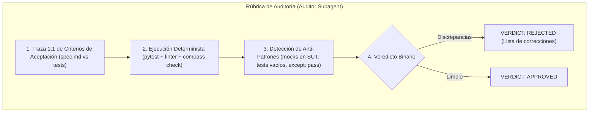

# Guía de Ingeniería (Paso 7): El Patrón Maker-Checker, Mitigación de Builder Blindness y Rúbricas Adversariales para Modelos Rápidos

Esta guía didáctica explica la fundamentación teórica y técnica detrás de la introducción del **Subagente Auditor** en el paso `07-auditor-subagent` de Compass Harness.

---

## 1. Lente de Ingeniería de Software: El Patrón Maker-Checker y Builder Blindness

### 1.1. Por qué los desarrolladores (humanos e IA) tienen sesgos de confirmación
En desarrollo de software tradicional, existe un principio organizativo clásico: **quien escribe el código no debe ser el único que lo audite antes de integrarlo**. En entidades financieras y sistemas críticos, este principio se formaliza bajo el nombre de **Maker-Checker** (o *Four-Eyes Principle*): una persona diseña/ejecuta la transacción o funcionalidad, y un segundo par de ojos independiente la aprueba.

En el desarrollo asistido por Inteligencia Artificial, este problema no solo se mantiene, sino que se agrava por el fenómeno de **Builder Blindness** (ceguera de taller):
1. **In-Context Fatigue**: Durante la fase `RED -> GREEN -> REFACTOR`, el modelo implementador llena su ventana de contexto con fallos intermedios, comandos de prueba, ajustes sintácticos y racionalizaciones de por qué su código "debería" funcionar.
2. **Tests Tautológicos**: Un modelo forzado a poner tests en verde tiende a adaptar la aserción a la salida actual de la función (`assert resultado == resultado`), en lugar de comprobar el invariante de dominio real definido en la especificación.
3. **Mocks Excesivos**: El implementador tiende a aislar tanto la prueba que acaba probando el mock y no la realidad del sistema integrado.

### 1.2. El Valor del Contexto Limpio (*Fresh Context Window*)
El verdadero salto de calidad al introducir un subagente auditor radica en la **limpieza de su contexto**. 
Al invocar un nuevo subagente con contexto vacío:
- No hereda el historial de intentos fallidos.
- Su punto de partida es la especificación (`spec.md`) y el resultado final (`git diff`).
- Se convierte en un evaluador puramente objetivo.

---

## 2. Lente de Dominio: Arquitectura de Subagentes y Economía de Tokens

### 2.1. El Dilema del Coste: ¿Por qué no usar el modelo Pro para auditar?
Los modelos de razonamiento avanzado (como Gemini Pro o Claude Opus) son costosos en tiempo y cuota de tokens. Si cada feature requiere que el modelo principal analice cientos de líneas de diff y ejecute suites de tests, la ventana de contexto de la conversación principal se degrada rápidamente (*Context Rot*), elevando el coste por turno.

La clave de ingeniería de arneses consiste en **especializar modelos según la tarea**:
- **Main Agent (Orquestador / Arquitecto - Modelo Potente)**: Alta capacidad de abstracción, negociación con el usuario, redacción de `spec.md` y síntesis educativa en `guides/`.
- **Builder Subagent (Constructor - Modelo Rápido `flash`)**: Ciclo rápido TDD `RED -> GREEN -> REFACTOR` en bucle cerrado.
- **Auditor Subagent (Revisor Adversarial - Modelo Rápido `flash`)**: Evaluación focalizada contra una rúbrica cerrada.

### 2.2. La Rúbrica de 4 Puntos: Cómo blindar a un modelo `flash` contra la complacencia
Un modelo rápido al que se le pide vagamente *"Revisa este código"* tenderá a ser complaciente y responder *"Todo parece correcto"*.

Para transformar un modelo ligero en un auditor implacable, la instrucción debe ser **adversarial, de solo lectura y estructurada en una máquina de estados binaria**:

#### Los 4 Puntos de la Rúbrica:
1. **Trazabilidad 1:1 de Criterios de Aceptación**:
   El auditor debe citar obligatoriamente qué línea de test valida cada `CA-X`. Si un criterio no tiene test, el veredicto es automáticamente `REJECTED`.
2. **Ejecución Determinista de Comandos**:
   El auditor ejecuta de forma independiente la suite (`pytest` y `compass check`). Si algo falla, el veredicto es `REJECTED`.
3. **Inspección de Anti-Patrones de IA**:
   El auditor busca activamente atajos habituales de agentes:
   - Funciones que retornan constantes para pasar un test.
   - Bloques `try/except: pass` que ocultan errores.
   - Tests que mockean el propio objeto que pretenden verificar (*mocking the SUT*).
4. **Veredicto Binario y Feedback Loop Desacoplado**:
   El auditor **nunca escribe código**. Si detecta problemas, emite `VERDICT: REJECTED` con una lista numerada de fallos. El Orquestador recibe este informe y reenvía una instrucción concisa al Builder Subagent para que sea él quien aplique las correcciones.

---

## 3. Conclusión y Buenas Prácticas
Con este patrón, Compass Harness implementa una arquitectura **Planner-Builder-Auditor** completamente desacoplada:
- Cero ceguera de taller.
- Cero desperdicio de cuota en el modelo orquestador.
- Contexto principal siempre limpio y listo para continuar guiando el proyecto.
